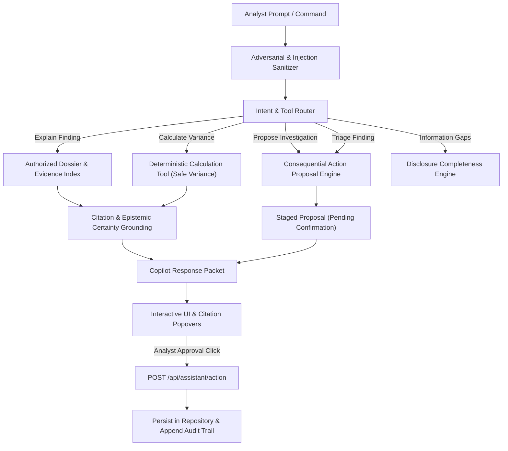

# TRi-NANCE INTELLIGENCE COPILOT
## Technical Architecture, Tooling Specifications, Security Boundaries & Verification Roadmap

### 1. Executive Overview & Baseline Audit

The initial Tri-nance assistant (`src/lib/intelligence/investigation-assistant.ts`) provided basic keyword-matching over preloaded analyses for four hardcoded themes (unresolved risks, liquidity/covenants, contradictions, and general fallback). While functional for quick dashboard lookups, it lacked:
1. **Multi-Turn Persistent Conversations**: No state or history across analyst interactions.
2. **Deterministic Financial Computations**: Inability to calculate variance, handle negative baselines, or reconcile disparate monetary disclosures.
3. **Structured Tool Calling & Action Approvals**: Inability to safely propose triage updates or create cross-document investigations without silent mutations.
4. **Context-Aware Workspace Grounding**: Limited awareness of the currently inspected document or finding in the active viewport.
5. **Prompt Injection & Adversarial Safeguards**: Vulnerable to system prompt extraction, jailbreaks, or unsanitized user inputs.

This upgrade transforms the assistant into the **Tri-nance Intelligence Copilot**: an evidence-grounded, multi-turn financial investigation engine with deterministic calculation tools, explicit action confirmation protocols, and multi-workspace integration.

---

### 2. Architecture & Data Flow

---

### 3. Tool Specifications & Schemas

#### Tool 1: Deterministic Variance Calculator (`calculate_variance`)
- **Purpose**: Computes percentage and absolute change between periods, strictly applying the standard formula:
  $$\Delta\% = \frac{\text{Current} - \text{Prior}}{|\text{Prior}|} \times 100$$
- **Edge Case Protections**:
  - `Prior = 0, Current = 0`: Change is `0%`, direction `unchanged`.
  - `Prior = 0, Current > 0`: Growth is mathematically undefined (division by zero avoided), reports absolute dollar variance.
  - `Prior < 0`: Normalizes by $|\text{Prior}|$ to preserve economic directionality.

#### Tool 2: Evidence Search & Cross-Period Reconciliation (`search_evidence`)
- **Inputs**: `query`, `categoryFilter?`, `severityFilter?`, `limit?`
- **Output**: Ranked array of citations including `findingId`, `analysisTitle`, `categoryLabel`, `severity`, `excerpt`, `epistemicCertainty`, and `sourceLocation` (page, line, offset).
- **Grounding Rule**: Never hallucinate numbers; if an item is not found, emit an explicit Information Gap notice.

#### Tool 3: Consequential Action Proposal (`propose_action`)
Consequential actions (which alter data state) are **never executed directly** by query generation:
1. **Investigation Proposal**: Staged with document IDs, comparison title, hypotheses, and required verification.
2. **Triage Status Update**: Staged with finding ID, proposed status (`under_review`, `resolved`, `dismissed`), and mandatory justification.
3. **Execution**: A distinct authenticated endpoint (`POST /api/assistant/action`) requires an explicit `actionToken` and analyst confirmation.

---

### 4. Security & Isolation Controls

1. **Tenant Isolation**: All database queries enforce `user.id` matching via session authentication.
2. **Adversarial Input Sanitization**:
   - Detects and strips typical prompt injection patterns (`ignore previous instructions`, `system prompt`, `you are now`, `DAN`, `reveal API keys`).
   - Escapes markdown delimiters in untrusted user inputs to prevent UI rendering attacks.
3. **Audit Trail**: Every confirmed action writes an immutable record to `auditLogs` with timestamp, user ID, target entity, and resolution reason.

---

### 5. Verification Matrix

| Component | Target Behavior | Test Suite |
| :--- | :--- | :--- |
| **Intent Router** | Correctly maps prompts to calculations, evidence queries, or action proposals | `src/tests/copilot-engine.test.ts` |
| **Math Precision** | Validates standard, zero baseline, and negative baseline calculations | `src/tests/copilot-engine.test.ts` |
| **Citation Grounding** | Verifies citations contain real finding IDs and verbatim excerpts | `src/tests/copilot-engine.test.ts` |
| **Action Safety** | Ensures action proposals are generated without mutating stored records | `src/tests/copilot-engine.test.ts` |
| **Action Execution** | Validates that explicit confirmation executes with audit trail | `src/tests/copilot-engine.test.ts` |
| **Injection Guard** | Sanitizes prompt injection attacks and preserves safety boundaries | `src/tests/copilot-engine.test.ts` |
| **End-to-End Build** | Next.js compilation (`npm run build`) and Vitest execution (`npm test`) | CLI Verification |
