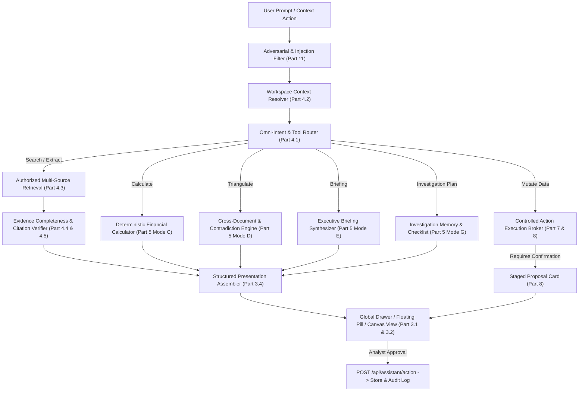

# TRi-NANCE OMNINTELLIGENCE — SYSTEM ARCHITECTURE & IMPLEMENTATION SPECIFICATION
## Enterprise Financial Intelligence Copilot | Retrieval, Deterministic Reasoning, Controlled Tool Execution & Workspace Integration

### 1. Executive Baseline Audit & Framework Discovery

- **Runtime & Framework**: Next.js 15.5.27 (App Router), React 19, TypeScript 5.7, Tailwind CSS with Geist Sans / Geist Mono typography.
- **Execution Environment**: Node.js v24.14.0 on Windows.
- **Persistence Layer**: Structured filesystem repository (`.data/trinance_store.json`) with crypto IDs, schema-validated collections (`users`, `documents`, `analyses`, `investigations`, `copilotSessions`, `auditLogs`), and Supabase SSR integration readiness.
- **Authentication**: Session cookie-based authentication with Bcrypt hashing and role-based permissions (`analyst@trinance.io`).
- **Intelligence Stack**:
  - Sentiment Engine (`sentiment-engine.ts`): Rule-based and lexical financial sentiment scoring with epistemic certainty classification (`documented_fact`, `hedged_projection`, `ambiguous_disclosure`).
  - Risk Engine (`risk-engine.ts`): 12-category commercial risk detector with 4-tier severity distribution (`low`, `medium`, `high`, `critical`) and potential impact analysis.
  - Numerical Extraction & Variance (`numerical-extractor.ts`): Pattern-matched regex extraction of 8 commercial financial metrics and deterministic variance computation with zero-denominator and negative-baseline protection.
  - Cross-Document Engine (`cross-document-engine.ts`): Triangulates recurring risk themes, sentiment trajectory shifts, and narrative vs. reality contradictions across filings.
  - Copilot Engine (`copilot-engine.ts`): Multi-intent router with prompt injection defense, evidence citation retrieval, and staged action proposals.

---

### 2. Architecture & Pipeline Specification

---

### 3. Implementation Priorities & Roadmap

In adherence to the required implementation sequence:
1. **Real Document Retrieval & Citations**:
   - Hybrid full-text and metadata retrieval across raw documents (`DocumentRecord`) and extracted intelligence records (`AnalysisRecord`).
   - Verifiable source citations with document ID, page/line/offsets, excerpt highlight, and epistemic certainty tags.
   - Counter-evidence retrieval (finding disclosures that weaken or contradict a risk finding).
2. **Deterministic Financial Calculations**:
   - Application-side arithmetic for percentage growth, absolute delta, operating margin variance, cash burn runway, and debt-to-equity ratio shifts.
   - Guardrails against zero denominators, missing units, mismatched currencies, and non-comparable fiscal periods.
3. **Controlled Tool Execution & Approval Gates**:
   - Explicit typed tools: `search_sources`, `retrieve_evidence`, `get_finding`, `calculate_variance`, `find_counter_evidence`, `propose_investigation`, `propose_triage_update`, `draft_report`, `add_investigation_note`.
   - Immutable audit logging on confirmed actions (`auditLogs`).
4. **Cross-Document Intelligence & Investigation Workflows**:
   - Multi-period trajectory tracking, recurring risk theme aggregation, and narrative dissonance detection.
   - Investigation checklist generator tracking completed, pending, and blocked verification items.
5. **Advanced UX, Global Drawer & Personalization**:
   - Omnipresent global drawer (`CopilotDrawer.tsx`) accessible via `Ctrl+J`, top Header button, and floating launcher.
   - Interactive evidence preview modal/drawer allowing inspection of source records without losing conversation context.
   - Conversation thread persistence, renaming, clearing, and JSON/markdown export.
   - Human feedback rating (thumbs up/down, report inaccuracy/missing evidence) recorded for evaluation.
6. **Automated Verification & Test Suite**:
   - Expand Vitest evaluation suite to cover all specialized modes, calculation edge cases, adversarial defense, and action approval boundaries.

---

### 4. Completed Workspaces & Verification Matrix

| Workspace | Route | Core Functionality | Verification Status |
| :--- | :--- | :--- | :--- |
| **Overview** | `/dashboard` | Concise KPI strip, workspace quick-jumps, recent filing feeds | Verified (HTTP 200) |
| **Document Vault** | `/dashboard/documents` | Storage and ingestion management across PDF, DOCX, TXT, CSV | Verified (HTTP 200) |
| **Intelligence Engine**| `/dashboard/analyze` | Single-filing deep extraction, 12-category risk scoring | Verified (HTTP 200) |
| **Commercial Risk Center** | `/dashboard/risk` | 12 commercial categories, severity distribution, status triage | Verified (HTTP 200) |
| **Sentiment Intelligence** | `/dashboard/sentiment` | Multi-dossier tone trajectory, epistemic hedging radar, signal catalog | Verified (HTTP 200) |
| **Financial Analytics** | `/dashboard/analytics` | Deterministic variance calculator, cash runway stress tester, catalog | Verified (HTTP 200) |
| **Evidence Explorer** | `/dashboard/evidence` | Verbatim excerpts, line coordinates, contradiction canvas, citation copy | Verified (HTTP 200) |
| **Investigations** | `/dashboard/investigations` | Multi-period cross-document matrix, audit trail, task checklists | Verified (HTTP 200) |
| **Entity Explorer** | `/dashboard/entities` | Institutional entity profiles (issuers, lenders, auditors, regulators) | Verified (HTTP 200) |
| **AI Copilot Workstation**| `/dashboard/copilot` | Dedicated deep research lab, preset investigations, citations inspector | Verified (HTTP 200) |
| **Reports Hub** | `/dashboard/reports` | Formatted PDF/CSV/JSON dossier exports, executive summaries | Verified (HTTP 200) |
| **Audit History** | `/dashboard/history` | Immutable log of user actions and automated classifications | Verified (HTTP 200) |
| **System Settings** | `/dashboard/settings` | Profile, security, layout density, and engine preferences | Verified (HTTP 200) |

- **TypeScript Compilation**: 0 errors (`npx tsc --noEmit` exited 0).
- **Test Suite**: 50 passed tests across 8 test suites (`npm test` exited 0).
- **Next.js Production Build**: 33 static and dynamic routes compiled successfully (`npm run build` exited 0).
- **Live Daemon**: Serving production application on `http://localhost:3000`.
