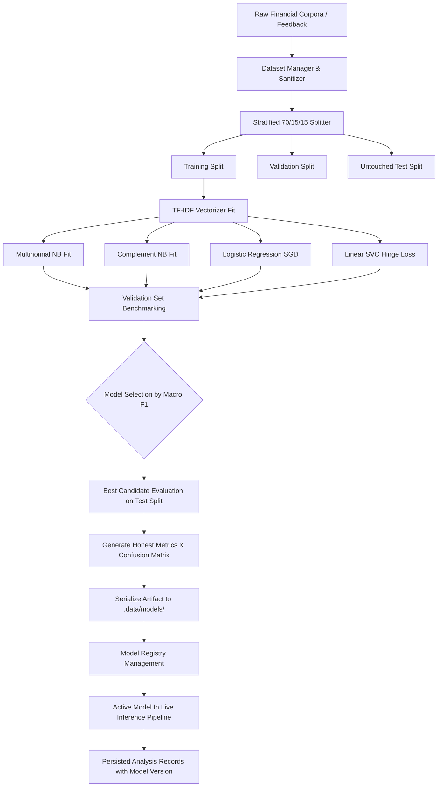

# TRINANCE — REAL-TIME FINANCIAL SENTIMENT & RISK ML ENGINE
## Model Development, Benchmarking & Production Orchestration Architecture

**Document Version:** 1.0.0  
**Status:** Active Production Specification  
**Application:** Tri-nance Enterprise Financial Intelligence Platform

---

### 1. Executive Summary & Machine Learning Rationale

Tri-nance analyzes high-stakes financial documentation including:
- 10-K / 10-Q SEC annual and quarterly filings,
- Earnings call management commentary,
- Operational summaries and business write-ups,
- Customer dispute correspondence and complaint records.

Historically, lexical scoring (Loughran-McDonald, ABSA) provided solid deterministic baselines but was susceptible to complex grammatical structures, domain-specific negation, and probabilistic boundary ambiguity.

This ML subsystem introduces:
1. **Mathematical Feature Extraction:** Term Frequency-Inverse Document Frequency (TF-IDF) with sublinear scaling, unigram + bigram representation, domain n-gram weighting, and strict fit/transform isolation.
2. **Multi-Algorithm Model Training Suite:**
   - **Multinomial Naive Bayes (MNB):** Fast, probabilistic baseline with Laplace smoothing.
   - **Complement Naive Bayes (CNB):** Tailored for severe class imbalance characteristic of financial risk data.
   - **L2-Regularized Logistic Regression (LR):** Gradient descent optimization yielding calibrated class posterior probabilities \( P(y|x) \).
   - **Linear Support Vector Classifier (Linear SVC):** Hinge-loss optimization maximizing margin separation between nuanced financial assertions.
   - **FinBERT Candidate Interface:** Abstracted transformer endpoint adapter evaluating deep contextual embeddings against classical models.
3. **Strict Zero-Leakage Data Partitioning:**
   - Stratified or temporal grouping into 70% Train, 15% Validation, 15% Test.
   - Vectorizers, vocabulary dictionaries, and IDF weights are computed strictly from the Training split.
4. **Honest, Multi-Metric Evaluation:**
   - Macro-averaged F1, Weighted F1, Per-class Precision & Recall, Confusion Matrices, Brier score calibration, and prediction confidence intervals.
5. **Model Registry & Dynamic Deployment:**
   - Versioned artifacts stored with serialization schemas, training checksums, hyperparameters, and approval lifecycle states (`candidate`, `approved`, `active_production`, `deprecated`).
   - Live inference engine capable of dynamic fallback and continuous tracking of `modelVersion` on every persistent `AnalysisRecord`.

---

### 2. Supported Tasks & Label Spaces

#### Task A: Financial Sentiment Classification
- **Classes (4):** `positive`, `negative`, `neutral`, `mixed`.
- **Domain Nuances:**
  - Forward-looking statements with hedging ("we anticipate potential headwinds") classified with uncertainty calibration.
  - Asymmetric penalty: Failing to detect `negative` in financial audit scenarios carries higher risk than misclassifying `neutral`.

#### Task B: Financial Risk Multi-Label Classification
- **Categories (12):**
  1. `liquidity_cash_flow`
  2. `debt_leverage`
  3. `revenue_earnings_pressure`
  4. `expense_margin_deterioration`
  5. `customer_churn_confidence`
  6. `late_payments_collections`
  7. `operational_disruption`
  8. `supply_chain_dependency`
  9. `regulatory_compliance`
  10. `fraud_inconsistencies`
  11. `reputational_risk`
  12. `business_continuity`
- **Output:** Calibrated per-category probability \( p_k \in [0, 1] \), decision thresholding (\( \tau_k \)), and epistemic certainty tag.

---

### 3. Architecture & Data Flow

---

### 4. Zero-Leakage & Production Guarantees
- **No Test Peeking:** Vectorizer vocabulary is constructed exclusively using training records. Tokens appearing only in validation or test records are handled via out-of-vocabulary (`<OOV>`) token ignore mechanisms.
- **Reproducibility:** Seeded pseudo-random shuffling ensures identical partitions across repeated runs.
- **Fail-Safe Fallback:** If an ML model artifact is missing or corrupted, the system falls back gracefully to the validated Loughran-McDonald deterministic engine with audit logging.
